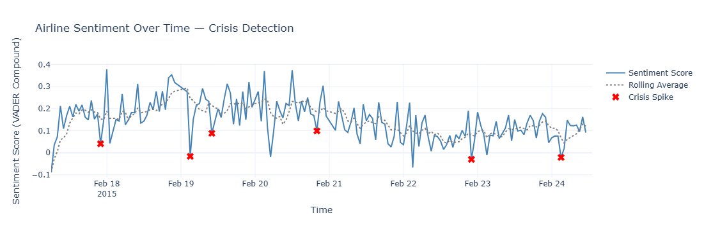
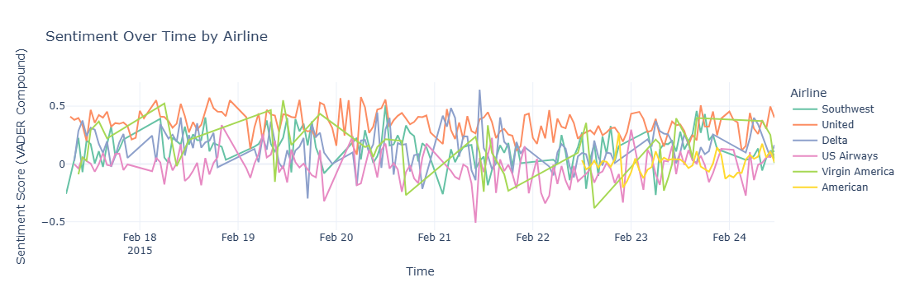
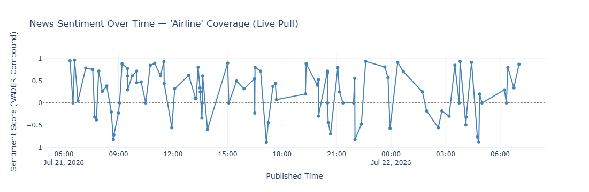

# Media Sentiment & Brand Crisis Detection

> Scoring public sentiment toward a brand over time, validating the scoring
> method against human labels, and automatically flagging the moments where
> sentiment drops sharply enough to look like a PR crisis.


---

## Overview

A corporate communications team wants to know one thing early: **is sentiment
about us falling off a cliff right now?** This project builds the pipeline that
answers it, on two data sources:

1. **Historical** — 14,640 labelled tweets about six US airlines (Kaggle, Feb 2015)
2. **Live** — news articles pulled in real time from the NewsAPI.org API

The labelled dataset is what makes this more than a sentiment demo: because every
tweet carries a human label, the scoring method can be **measured** before it is
trusted on live data where no labels exist.

---

## What it does

| Stage | What happens |
| --- | --- |
| **Score** | VADER compound sentiment on every tweet, thresholded at ±0.05 into negative / neutral / positive |
| **Validate** | Compare VADER and TextBlob against the human labels and quantify where they fail |
| **Detect** | Aggregate hourly, compare each hour to a rolling 6-hour mean, flag drops beyond 1.5σ |
| **Corroborate** | Attach a real negative tweet from each flagged hour, so a spike can be read, not just trusted |
| **Compare** | Break sentiment down per airline to benchmark brands against each other |
| **Extend** | Run the same scoring over live NewsAPI articles to confirm the approach generalises |

---

## Results

### Crisis detection



Hourly mean sentiment against its rolling 6-hour average. Hours with fewer than
10 tweets are dropped so low-volume periods cannot fake a spike. Six hours fell
more than 1.5 standard deviations below the rolling mean:

| Hour (UTC) | Mean sentiment | Sampled complaint |
| --- | ---: | --- |
| 2015-02-17 22:00 | 0.041 | bags delayed after a response from United |
| 2015-02-19 03:00 | −0.016 | Virgin America service complaint |
| 2015-02-19 10:00 | 0.088 | Virgin America |
| 2015-02-20 20:00 | 0.099 | "Stuck in this airport 12 hours…" (United) |
| 2015-02-22 22:00 | −0.030 | Virgin America booking failure |
| 2015-02-24 03:00 | −0.021 | United flight disruption |

Every flagged hour is backed by a real negative tweet from that hour — the
detector is not firing on noise.

### Brand comparison



United held the most consistently positive sentiment across the window. US
Airways and Virgin America were more volatile and averaged lower, including a
sharp dip for US Airways around 21 February. This is closer to how a brand
monitoring team actually works — benchmarking against competitors rather than
watching one line in isolation.

### Live news sentiment



The same scoring applied to a live NewsAPI pull, confirming the pipeline runs on
streaming data and not just a static CSV.

---

## The validation result, and why it matters

| Method | Agreement with human labels |
| --- | ---: |
| VADER | **49.0%** |
| TextBlob | **45.3%** |

**These are low numbers, and reporting them is the point.** Both tools fail the
same way: airline complaints are frequently sarcastic or politely worded.

> *"thanks for losing my bag"* · *"please secure the footrest"*

Lexicon-based scorers read "thanks" and "please" and return positive. They match
words, not meaning. A pipeline that skipped this check would have shipped
sentiment scores roughly as good as a coin flip on a three-class problem, with
nothing to reveal it.

The crisis detection still works despite this, because it keys off **relative
change** in the hourly average rather than absolute accuracy on any single
tweet — a systematic bias cancels out when every hour carries it equally.

---

## Running it

```bash
git clone https://github.com/YOUR_GITHUB_USERNAME/media-sentiment-crisis-detection.git
cd media-sentiment-crisis-detection
pip install -r requirements.txt
jupyter notebook notebooks/media-sentiment-crisis-detection.ipynb
```

TextBlob needs its corpora on first use:

```bash
python -m textblob.download_corpora
```

**Section 2 (the Kaggle analysis) runs as-is** — the data is in the repo.

**Section 1 (the live news pull) needs a free API key:**

```bash
cp .env.example .env
# then add your key from https://newsapi.org/register
```

> **Viewing on GitHub:** the charts are Plotly, which GitHub's notebook preview
> cannot run — those cells will look empty there. The PNGs above are exports of
> the same figures. For the interactive versions, run the notebook locally or
> open it in [nbviewer](https://nbviewer.org).

---

## Project structure

```
media-sentiment-crisis-detection/
│
├── README.md
├── LICENSE
├── requirements.txt
├── .env.example                 NEWSAPI_KEY — no real key is committed
│
├── notebooks/
│   └── media-sentiment-crisis-detection.ipynb
│
├── data/
│   ├── Tweets.csv               14,640 labelled tweets, Feb 2015
│   └── data-dictionary.md       columns, distributions, provenance
│
└── assets/
    ├── crisis-detection.png
    ├── sentiment-by-airline.png
    └── live-news-sentiment.png
```

---

## Data

14,640 tweets across six airlines, 16–24 February 2015, human-labelled
62.7% negative / 21.2% neutral / 16.1% positive. Full column reference:
[data/data-dictionary.md](data/data-dictionary.md).

The live source is NewsAPI.org, queried for English-language articles matching
`"airline"`. Pulls are git-ignored since they change on every run.

---

## Method notes

**Why 1.5σ and a 6-hour window.** The rolling window has to be long enough to
establish a baseline but short enough to still react within a working day.
1.5σ was chosen over the conventional 2σ deliberately: in crisis monitoring a
missed event costs far more than a false alarm someone spends two minutes
dismissing.

**Why the 10-tweet floor.** Overnight hours can carry a handful of tweets, where
one angry customer swings the mean hard. Without the floor the detector mostly
flags quiet hours.

**Why the sample tweet is attached.** A flagged timestamp is not actionable on
its own. Pulling a real negative tweet from the same hour turns the alert into
something a human can judge in seconds.

---

## Limitations

- **Lexicon-based scoring is the weak link** — ~49% agreement with human labels.
  A fine-tuned transformer classifier (e.g. BERT) would handle sarcasm and
  context far better, at the cost of needing training data and a GPU.
- **The historical window is 9 days in 2015**, so the crisis patterns found are
  specific to that period and those six carriers.
- **No statistical significance testing** on the airline-to-airline differences —
  Virgin America has 504 tweets against United's 3,822, so its line is noisier
  and the comparison is directional rather than conclusive.
- **NewsAPI's free tier** limits history and request volume, so the live section
  is a demonstration of the mechanism rather than a continuous monitor.

---

## Possible next steps

| | Enhancement | Why |
| --- | --- | --- |
| 1 | Fine-tuned transformer classifier | Directly addresses the sarcasm failure — the single biggest limitation |
| 2 | Scheduled pull + alerting | Turn the notebook into a job that posts to Slack or email when a crisis fires |
| 3 | Tune thresholds against the labels | The 1.5σ / 6-hour / 10-tweet choices were reasoned, not optimised — the labelled set allows a precision/recall sweep |
| 4 | Use `negativereason` | The dataset already categorises complaints, so an alert could name *what* went wrong, not just that something did |
| 5 | Topic modelling on flagged hours | Surface the driver of a spike automatically rather than by reading a sample tweet |

---

## Author


**Priyal Parmar**

[](https://linkedin.com/in/priyal-parmar-0b60a71b2)
[](https://github.com/priyalparmar-analytics)
[](mailto:priyalparmar1511@gmail.com)
